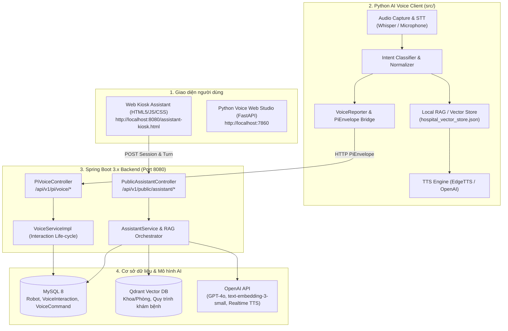

# TÀI LIỆU TỔNG QUAN KIẾN TRÚC & CHỨC NĂNG HỆ THỐNG AI VOICE & KIOSK ASSISTANT
**Dự án:** MediAssist Rover (MAR) - AI Voice & Hospital Kiosk  
**Nhánh Git:** `feature/ai-voice-rag-mentorpi`  
**Ngày cập nhật:** 01/11/2026  

---

## 1. Mục tiêu & Bối cảnh hệ thống
Dự án **AI_VOICE** là giải pháp trợ lý AI tương tác giọng nói và văn bản cho Robot y tế bệnh viện, gồm 2 kịch bản vận hành chính:
1. **Kiosk Web Trợ lý Bệnh viện (Public Assistant Kiosk):** Người bệnh hoặc khách tại bệnh viện đứng trước màn hình Kiosk của Robot để tra cứu thông tin khoa/phòng, quy trình khám bệnh, danh sách bác sĩ, chỉ đường thông qua giọng nói hoặc nhập văn bản.
2. **AI Voice Edge Client (MentorPi / Edge Robot Engine):** Mã nguồn Python chạy trực tiếp trên bộ máy tính nhúng của Robot (Raspberry Pi/MentorPi hoặc máy trạm Windows/Linux), thực hiện thu âm micro, nhận dạng tiếng nói (STT), phân loại ý định (NLU/Intent), tra cứu tri thức cục bộ (RAG), tổng hợp giọng nói (TTS) và đồng bộ trạng thái tương tác về Spring Boot Backend thông qua chuẩn PiEnvelope.

---

## 2. Sơ đồ kiến trúc tổng thể (System Architecture)



---

## 3. Chi tiết 2 Giao diện & Chức năng Vận hành

### 3.1. Giao diện Web Kiosk Bệnh viện (`assistant-kiosk.html`)
* **File nguồn:** `backend/src/main/resources/static/assistant-kiosk.html`
* **Địa chỉ truy cập:** `http://localhost:8080/assistant-kiosk.html`
* **Cấu tạo giao diện:**
  1. **Cột cấu hình & Mở phiên (Sidebar):**
     * **Robot ID:** Nhập mã định danh UUID của Robot đã cấp phép trong hệ thống:
       `d8c8cfcb-9df9-4bda-adbf-c0cc4ff9cf10`
     * **Ngôn ngữ:** Hỗ trợ `Tiếng Việt` (`vi-VN`) hoặc `English` (`en-US`).
     * **Microphone:** Cho phép lựa chọn mic đầu vào từ danh sách thiết bị âm thanh trình duyệt.
     * **Nút "Mở phiên":** Gửi lệnh khởi tạo phiên làm việc lên Backend.
  2. **Khu vực tương tác Robot Face & Chat (Assistant Stage):**
     * **Khuôn mặt Robot hoạt họa (CSS Animated Face):** Có anten phát tín hiệu, mắt chớp cử động, miệng chuyển động (nói) đồng bộ theo trạng thái âm thanh trả về từ AI.
     * **Khung chat tương tác & Nút Mic (Push-to-Talk):** Cho phép người dùng gõ câu hỏi hoặc nhấn giữ để nói trực tiếp.
     * **Audio Player tự động:** Nhận luồng âm thanh WAV do Backend tổng hợp (`/api/v1/public/assistant/turns/{id}/audio`) và tự động phát qua loa.

### 3.2. Giao diện Python Web Studio (`run_web.ps1`)
* **File nguồn:** `src/web/app.py`
* **Địa chỉ truy cập:** `http://localhost:7860`
* **Mục đích:** Giao diện kiểm thử trực quan cho kỹ sư AI:
  * Kiểm tra chất lượng và độ trễ các engine TTS: EdgeTTS, gTTS, OpenAI TTS.
  * Thử nghiệm nhận dạng giọng nói STT tiếng Việt.
  * Đánh giá độ chính xác của cơ chế phân loại Intent và tìm kiếm tri thức RAG trên dữ liệu bệnh viện trước khi đưa vào sản xuất.

---

## 4. Cấu trúc thư mục mã nguồn (Codebase Layout)

```text
AI_VOICE/
├── backend/                               # Spring Boot 3.x Backend (Java 17+)
│   ├── src/main/java/com/mediassistrover/backend/
│   │   ├── assistant/                     # Module RAG Kiosk (AssistantService, DTOs, Prompts)
│   │   ├── controller/
│   │   │   ├── assistant/PublicAssistantController.java  # API Kiosk phục vụ công cộng
│   │   │   ├── pi/PiVoiceController.java                 # API nhận Event từ Robot nhúng
│   │   ├── service/impl/VoiceServiceImpl.java            # Quản lý vòng đời Voice Interaction
│   │   └── security/                      # DevicePrincipal & Public RateLimiting
│   └── src/main/resources/static/assistant-kiosk.html    # Frontend Web Kiosk
│
├── src/                                   # Python AI Voice Engine (Edge Client)
│   ├── api/voice_reporter.py             # HTTP Client gửi Interaction/Command lên Backend
│   ├── audio/                            # Thu âm microphone & STT (Whisper)
│   ├── intent/                           # Bộ phân loại ý định người dùng (Regex/LLM)
│   ├── rag/vector_store.py               # Tìm kiếm văn bản bệnh viện nhúng
│   ├── tts/                              # Bộ chuyển văn bản thành tiếng nói (EdgeTTS, OpenAI)
│   ├── utils/envelope.py                 # Chuẩn hóa PiEnvelope DTO (producerSessionId, UUID)
│   └── main.py                           # CLI chạy vòng lặp lắng nghe trên Robot
│
├── data/                                  # Dữ liệu tài liệu bệnh viện (quy trình khám, bác sĩ)
├── tests/                                 # 40 bài unit test pytest (đã PASS 100%)
└── run_voice.ps1 / run_web.ps1            # Scripts khởi chạy nhanh trên Windows
```

---

## 5. Hợp đồng API & Giao thức truyền tin (API Contracts)

### A. Luồng Kiosk Assistant (`PublicAssistantController`)
1. **Khởi tạo phiên làm việc:**
   * **Endpoint:** `POST /api/v1/public/assistant/sessions`
   * **Request:**
     ```json
     {
       "robotId": "d8c8cfcb-9df9-4bda-adbf-c0cc4ff9cf10",
       "language": "vi-VN"
     }
     ```
   * **Response (HTTP 201):**
     ```json
     {
       "sessionId": "12a9a503-f788-4f29-9809-ec6f472259df",
       "robotId": "d8c8cfcb-9df9-4bda-adbf-c0cc4ff9cf10",
       "channel": "KIOSK",
       "scope": "PUBLIC",
       "language": "vi-VN"
     }
     ```
2. **Gửi câu hỏi theo lượt (Turns):**
   * **Endpoint:** `POST /api/v1/public/assistant/sessions/{sessionId}/turns`
   * Hỗ trợ gửi `text/json` hoặc file âm thanh `multipart/form-data` (audio `.wav`).
   * Backend truy vấn tri thức RAG trên Qdrant -> gọi OpenAI hoàn thiện câu trả lời -> sinh audio phản hồi.
3. **Phát âm thanh câu trả lời:**
   * **Endpoint:** `GET /api/v1/public/assistant/turns/{turnId}/audio` (Stream WAV về Web Kiosk).

### B. Luồng Robot Edge Bridge (`PiVoiceController`)
Mọi giao tiếp từ Python Client lên Backend bắt buộc tuân theo chuẩn **`PiEnvelope`**:
* **Header:** `Authorization: Bearer <DEVICE_JWT_TOKEN>`
* **Cấu trúc Envelope:**
  ```json
  {
    "messageId": "11111111-1111-1111-1111-111111111111",
    "correlationId": "22222222-2222-2222-2222-222222222222",
    "timestamp": "2026-10-31T08:00:00Z",
    "producerSessionId": "33333333-3333-3333-3333-333333333333",
    "payload": { ... }
  }
  ```
* **Vòng đời lệnh thoại:**
  1. `POST /api/v1/pi/voice/interactions`: Mở phiên tương tác giọng nói (`ACTIVE`).
  2. `POST /api/v1/pi/voice/commands`: Báo cáo lệnh vừa nhận dạng được (kèm `status: "EXECUTED"` để đảm bảo tính toàn vẹn trạng thái).
  3. `POST /api/v1/pi/voice/interactions/{id}/completion`: Đóng phiên tương tác (`COMPLETED`).

---

## 6. Cấu hình Cơ sở dữ liệu & Robot được cấp phép
* **Database:** MySQL 8 (`backend_robot_v1`)
* **Robot phục vụ Kiosk công cộng:**
  * **UUID:** `d8c8cfcb-9df9-4bda-adbf-c0cc4ff9cf10`
  * **Robot Code:** `ROBOT_MAR_KIOSK`
  * **Tên hiển thị:** MediAssist Kiosk Robot
  * **Trạng thái:** `IDLE` (Sẵn sàng phục vụ)
  * **Cấu hình Backend:** Khai báo tại `ASSISTANT_PUBLIC_ROBOT_IDS` trong file `.env`.
