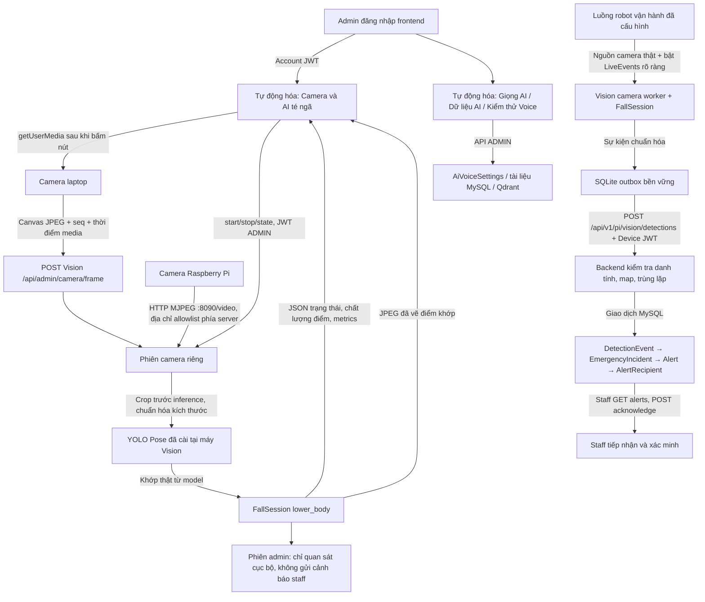
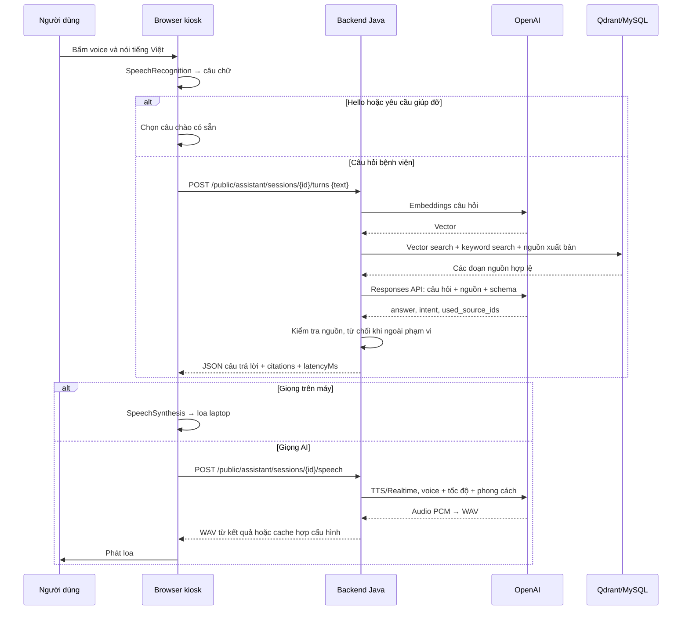

# Luồng tổng thể AI Voice và AI té ngã — 04/11/2026

## Trước phần thay đổi camera admin

Vision và Voice đã cùng repo và Backend. Nguồn Vision được cố định khi tiến trình khởi động; dashboard riêng ở cổng 8001. Trang admin chính chưa nhận được camera của trình duyệt để đưa qua model. Các bảng Vision và API sự kiện đã có, nhưng giao dịch MySQL thật chưa được kiểm tra ở lần bàn giao.

```mermaid
flowchart TB
 subgraph Vision
  Pi[Camera Pi USB/CSI] -->|HTTP MJPEG hoặc camera local OpenCV| PY[Python Vision]
  PY -->|YOLO Pose: tọa độ và confidence từng khớp| TR[Theo dõi người và luật hông/chân theo thời gian]
  TR -->|JSON quan sát| LOG[JSONL cục bộ]
  TR -->|UUID sự kiện + metrics| O[SQLite outbox]
  O -->|POST JSON + Device JWT| BE[Backend Java /pi/vision/detections]
  BE -->|simulation=true| DET[DetectionEvent]
  BE -->|simulation=false| ALERT[DetectionEvent → Incident → Alert → Recipient]
  ALERT -->|Staff polling REST 4 giây| STAFF[Staff web]
  STAFF -->|POST acknowledge| ACK[Recipient acknowledged / Alert ACKNOWLEDGED]
  PY -->|GET video MJPEG và state JSON| DASH[Dashboard Vision riêng]
 end
 subgraph Voice
  MIC[Mic laptop] -->|Browser SpeechRecognition| TXT[Văn bản]
  TXT -->|POST JSON| JAVA[AssistantService]
  JAVA -->|OpenAI embeddings| VECTOR[Vector câu hỏi]
  VECTOR -->|HTTP Qdrant + truy vấn MySQL| SOURCES[Nguồn bệnh viện]
  SOURCES -->|OpenAI Responses| ANSWER[Câu trả lời JSON + source IDs]
  ANSWER --> CHECK[Backend kiểm tra nguồn và phạm vi]
  CHECK -->|SpeechSynthesis hoặc OpenAI WAV| SPEAKER[Loa]
 end
```

## Sau phần thay đổi camera admin

Phiên thử admin và worker vận hành là hai đường khác nhau. Bấm camera trong admin không tự mở đường gửi live, kể cả môi trường vận hành đang cấu hình live. Browser không được truyền `simulation=false`. Cấu hình đời thực dùng danh tính DEVICE trên máy Vision/robot, không đưa DEVICE_SECRET vào frontend.

## Mỗi lần đổi loại dữ liệu dùng phương thức gì?

| Từ → đến | Dữ liệu và phương thức | Kiểm tra/rủi ro |
|---|---|---|
| Camera laptop → trình duyệt | getUserMedia → MediaStream → video/canvas | Cần cấp quyền; camera có thể bị ứng dụng khác giữ. Chỉ bật sau thao tác bấm. |
| Browser → Python Vision | HTTP POST `image/jpeg`, header session/sequence/media-time, Account JWT | Giới hạn 2 MB/frame, kích thước đầu vào, tối đa 8 FPS ở server; frontend gửi tối đa 6 FPS và một yêu cầu đang chờ. Mạng chậm làm giảm số khung. |
| Camera Pi → máy Vision | MJPEG HTTP qua OpenCV/FFmpeg; URI từ biến môi trường phía server | Phải cấu hình host allowlist; không nhận URI tùy ý từ browser. MJPEG hiện chưa mã hóa/xác thực, cần mạng robot được bảo vệ hoặc đường truyền bảo vệ. |
| JPEG → khớp | OpenCV decode/resize/crop → YOLOv8n pose ONNX | Đây là inference model thật. Crop không phải huấn luyện và không tái tạo góc nhìn camera thấp. |
| Khớp → trạng thái | COCO17 chuyển sang layout MP33, không điền điểm thiếu → tracker → luật thời gian | Cần hai hông và ít nhất một chân đủ hông–gối–mắt cá. Confidence điểm khớp không phải xác suất ngã. |
| Kết quả → admin | GET state JSON + GET snapshot JPEG có JWT | Khung quá 2,5 giây bị coi là cũ; không giữ ảnh cũ như ảnh live hoặc hiển thị an toàn giả. |
| Sự kiện vận hành → outbox | SQLite, body và simulation bất biến | Mất mạng chưa có receipt thì giữ pending; local log không chứng minh đã lưu MySQL. |
| Outbox → Backend | POST JSON + DEVICE_ACCESS JWT | Ràng buộc robot ID, token version/expiry, map hiện hành. Retry cùng UUID/body là duplicate; body đổi trả409. |
| Backend → MySQL | Giao dịch qua JPA | Mô phỏng chỉ DetectionEvent; live có FK sang Incident/Alert/Recipient. Không có map thì422. |
| DB → staff | REST GET alerts khi staff mở trang, mỗi4 giây; POST ACK | Có độ trễ polling. Không đồng nghĩa với push khi điện thoại/app đã đóng. |

## Luồng Voice chi tiết

### Kiosk/laptop

Browser STT là dịch vụ của trình duyệt, không phải Whisper được dự án gọi. ROS trên robot thu WAV, gửi `/api/v1/pi/assistant/sessions/{id}/turns`; backend thêm bước `/audio/transcriptions` để nhận chữ trước RAG. Python Voice Studio là nhánh riêng dùng kho JSON, không tự đồng bộ với MySQL/Qdrant của kiosk. Các lỗi có thể xảy ra: STT nghe sai, nguồn trùng/cũ, truy xuất thiếu đoạn, mô hình diễn đạt sai dù dẫn nguồn, mạng chậm, TTS không có quyền hoặc mic thu lại loa. Code ngắt mic khi nói và chặn phản hồi cũ sau dừng. `latencyMs` backend chưa gồm TTS robot; không được gọi đó là thời gian từ nói xong đến nghe loa.

## Database và API: có cần bảng mới không?

**Không thêm migration/bảng cho màn hình camera hoặc sự kiện ngã trong thay đổi này.** Tái sử dụng:

- `DetectionEvent`: dữ liệu quan sát và JSON metrics, confidence có thể null.
- `EmergencyIncident`: sự cố cần xác minh, FK DetectionEvent.
- `Alert`: thông báo, FK Incident và DetectionEvent.
- `AlertRecipient`: người nhận, trạng thái delivered/acknowledged.
- Voice tiếp tục dùng `VoiceInteraction`, `VoiceAssistantTurn`, `AssistantCitation`, các bảng Knowledge và `AiVoiceSettings`.

API mới ở Python Vision: `GET config/state/snapshot`, `POST start/stop/frame` dưới `/api/admin/camera`. Tất cả xác thực ADMIN qua backend `/api/v1/auth/me`; cache quyền tối đa2 giây. CORS chỉ cho frontend đã cấu hình. Lưu nhiều camera theo robot về sau có thể dùng `SystemSetting` có sẵn hoặc registry riêng khi có yêu cầu quản lý nhiều camera, lịch sử cấu hình và quyền theo robot. Hiện địa chỉ Pi là cấu hình server, không thêm cột tùy tiện vào Room/Zone.

## Kết quả kiểm tra và giới hạn

- Frontend build thành công; kiểm tra Edge bằng video thiết bị giả lấy từ clip đã có: click mới mở camera; JPEG đi qua model thật; nhận ảnh đã vẽ; crop trước inference; dừng giải phóng stream; không tràn trang ở390px; không có lỗi JS.
- Sáu kiểm thử camera: xác thực, không nhận live flag, dữ liệu JPEG/giới hạn, ownership, sequence, stop và khung cũ đều đạt.
- MySQL 8.4 Testcontainer thực và full Spring/MockMvc: lưu simulation không alert; duplicate sau đọc JSON từ MySQL; body đổi409; thiếu map422; live có FK đúng; STAFF đọc ghi DELIVERED rồi ACK thành ACKNOWLEDGED. Database thử bị hủy khi kết thúc, không phát cảnh báo đến nhân viên vận hành.
- Năm kiểm thử giao diện staff: fall WARNING được hiển thị, không lặp, đã ACK không báo mới, simulation không thành live alert.
- Một khung từ clip cũ: full frame thấy1 người, CALIBRATING_LOWER_BODY; cắt54% thấy1 người, vẫn đang lấy mốc. Thời gian model cold khoảng3718ms, mẫu warm47ms. Đây không phải benchmark Pi hoặc accuracy; chưa chứng minh bắt được sự kiện ngã trên camera thấp.
- Chưa nối phần cứng Raspberry Pi tại máy này; cần IP camera và kiểm tra mạng thực. Chưa có video đúng camera thấp để train/fine-tune. Không có push thông báo khi app điện thoại bị đóng.

## Việc tiếp theo để đạt kiểm chứng vận hành

1. Cấu hình camera Pi thật và đo FPS/độ trễ/mất gói khi robot đứng và di chuyển. Xác nhận USB/CSI và hình ảnh không bị crop sai.
2. Quay video đúng độ cao/góc lắp và có người hỗ trợ an toàn: đi, đứng, ngồi, quỳ, nhặt đồ, bị che, nhiều người, ngã sang hai bên/hướng camera. Gắn nhãn điểm khớp và thời gian bắt đầu/kết thúc sự kiện do người xác minh.
3. Chia tập theo người và video/buổi quay, giữ tập kiểm tra riêng; không chia các frame cạnh nhau vào cả train và test. Chỉ sau đó mới fine-tune model pose bằng dữ liệu người dùng sở hữu/được phép, rồi điều chỉnh luật ngã bằng tập validation.
4. Đo recall ngã, bỏ sót, false alarm/giờ, độ trễ phát hiện và tỷ lệ đủ khớp. Báo riêng từng tình huống che khuất/ngã hướng camera/robot chuyển động. Không suy accuracy từ unit test hoặc tỷ lệ đủ điểm.
5. Thử staff trên môi trường nghiệm thu được xác định và tài khoản/người nhận thử, xác nhận thông báo thực trên thiết bị. Phần REST + MySQL đã được thử cô lập; nghiệm thu thiết bị/người nhận thật cần bước riêng.

Bổ sung kiểm tra cuối: tổng50 bài Vision và17 bài launcher đạt. Luồng Pi streamer HTTP MJPEG loopback → OpenCV → ONNX thật đạt RUNNING với1 người; chưa nối Pi phần cứng.
