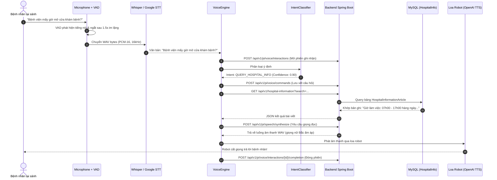

# TÀI LIỆU KIẾN TRÚC TOÀN DIỆN VÀ HƯỚNG DẪN TÍCH HỢP AI VOICE
## HỆ THỐNG ROBOT HỖ TRỢ BỆNH VIỆN THÔNG MINH (MEDIASSISTROVER)

> **Dự án:** MediAssistRover - AI Voice Assistant Subsystem  
> **Phiên bản tài liệu:** 1.0  
> **Ngôn ngữ:** Tiếng Việt (chính), Tiếng Anh (chuẩn kỹ thuật)  
> **Mục tiêu:** Cung cấp tài liệu thiết kế kiến trúc, phân tích mã nguồn và hướng dẫn tích hợp toàn diện phân hệ AI Voice với Backend Spring Boot, cơ sở dữ liệu MySQL, giao diện HMI Kiosk và phần cứng Raspberry Pi.

---

## MỤC LỤC
1. [Tổng quan Dự án và Bối cảnh Nghiệp vụ](#1-tổng-quan-dự-án-và-bối-cảnh-nghiệp-vụ)
2. [Phân tích 6 Phân hệ Nền tảng của MediAssistRover](#2-phân-tích-6-phân-hệ-nền-tảng-của-mediassistrover)
3. [Kiến trúc Phân hệ Trợ lý Giọng nói (AI Voice Pipeline)](#3-kiến-trúc-phân-hệ-trợ-lý-giọng-nói-ai-voice-pipeline)
4. [Mô hình Dữ liệu Database và Hợp đồng Giao tiếp (Data Contract)](#4-mô-hình-dữ-liệu-database-và-hợp-đồng-giao-tiếp-data-contract)
5. [Cơ chế Nhận dạng Ý định (Intent Classification) & Trích xuất Thực thể](#5-cơ-chế-nhận-dạng-ý-định-intent-classification--trích-xuất-thực-thể)
6. [Tối ưu hóa Hiệu năng và Độ trễ (Performance Optimizations)](#6-tối-ưu-hóa-hiệu-năng-và-độ-trễ-performance-optimizations)
7. [Hướng dẫn Vận hành, Kiểm thử và Triển khai Đa Môi trường](#7-hướng-dẫn-vận-hành-kiểm-thử-và-triển-khai-đa-môi-trường)

---

## 1. TỔNG QUAN DỰ ÁN VÀ BỐI CẢNH NGHIỆP VỤ

### 1.1. Sứ mệnh của MediAssistRover
Trong các bệnh viện hiện đại, áp lực lên đội ngũ điều dưỡng và nhân viên quầy tiếp đón là rất lớn:
- Bệnh nhân và thân nhân thường xuyên bối rối về vị trí các phòng khám, lịch khám, quy trình xét nghiệm, thủ tục bảo hiểm y tế.
- Việc nhân viên y tế phải dừng công việc chuyên môn để giải đáp các câu hỏi lặp đi lặp lại hoặc trực tiếp dẫn bệnh nhân đến từng phòng gây lãng phí thời gian quý giá.

**MediAssistRover (MAR)** được phát triển như một hệ sinh thái robot tự hành toàn diện, đảm nhận:
1. **Tiếp đón & Trả lời Hỏi đáp (Outpatient Information Assistance):** Giao tiếp tự nhiên bằng giọng nói tiếng Việt với bệnh nhân, tra cứu cơ sở dữ liệu bệnh viện thời gian thực.
2. **Dẫn đường Bệnh nhân (Patient Escort):** Tự hành dẫn người bệnh đến phòng khám chỉ định với tốc độ an toàn ($0.25\text{ m/s}$).
3. **Vận chuyển Dược phẩm An toàn (Secure Medical Delivery):** Giao nhận thuốc và bệnh phẩm nội viện có khóa bảo mật QR và Face ID.
4. **Giám sát & Cấp cứu Khẩn cấp (Safety Patrol & Emergency SOS):** AI camera phát hiện té ngã, co giật, và nút bấm SOS báo động tức thời đến phòng trực.

---

## 2. PHÂN TÍCH 6 PHÂN HỆ NỀN TẢNG CỦA MEDIASSISTROVER

Hệ thống MediAssistRover hoạt động dựa trên sự phối hợp đồng bộ của 6 phân hệ:

```
┌────────────────────────────────────────────────────────────────────────────────────────┐
│                               1. QUẢN TRỊ VIÊN & NHÂN VIÊN Y TẾ                        │
│   • FE_WEB (React / Vite)              : Quản trị bản đồ, phân luồng, báo cáo KPI       │
│   • UI app (React Native / Expo 58)    : Điều dưỡng điều phối robot, nhận cảnh báo SOS  │
└───────────────────────────────────────────▲────────────────────────────────────────────┘
                                            │ REST / JWT (BearerAuth)
                                            ▼
┌────────────────────────────────────────────────────────────────────────────────────────┐
│                               2. TRUNG TÂM ĐIỀU PHỐI (BACKEND)                         │
│   • BE_MAR (Java 21 / Spring Boot 3.5) : Workflow State Machine, EMQX MQTT Broker      │
│   • MySQL 8.4 (backend_robot_v1)       : HospitalInformation, VoiceInteraction, Jobs   │
│   • OpenAI TTS (gpt-4o-mini-tts)       : Tổng hợp giọng nói Tiếng Việt có WAV Cache    │
└───────────────────────────────────────────▲────────────────────────────────────────────┘
         ▲                                  │ DeviceBearerAuth / MQTTv5 TLS
         │ Event Topics (SOS, Fall)         ▼
┌────────┴──────────────────┐      ┌─────────────────────────────────────────────────────┐
│ 3. PHÂN TÍCH THỊ GIÁC AI  │      │ 4. PHÂN HỆ ROBOT TẠI BỆNH VIỆN                     │
│ • MAR_Fall_AI (FastAPI)   │      │ • Robot app (Expo 58 Kiosk UI trên màn hình robot)   │
│ • MediaPipe + YOLOv8 pose │      │ • Rasppi (Raspberry Pi 5 / ROS2 Humble Step Worker) │
│ • Seizure & SOS gesture   │      │ • AI_VOICE (Module Trợ lý Giọng nói Tiếng Việt này) │
└───────────────────────────┘      └─────────────────────────────────────────────────────┘
```

### Chi tiết vai trò từng folder:

1. **`BE_MAR` (Backend Spring Boot 3.5 & Java 21):**
   - Đóng vai trò hạt nhân trung tâm của hệ thống.
   - Quản lý cây thực thể hạ tầng cơ sở vật chất: `HospitalInformation` (bài viết FAQ), `Floor`, `Map`, `Room`, `Endpoint` (tọa độ Waypoint), `Zone`.
   - Vòng đời nhiệm vụ: `ServiceRequest` (nghiệp vụ người dùng) ➔ `Job` ➔ `JobTask` ➔ `JobStep`.
   - Đã tích hợp sẵn hạ tầng giọng nói: `VoiceInteraction`, `VoiceCommand`, `PiVoiceController`, `HospitalInformationQueryService` (thuật toán chấm điểm từ khóa tiếng Việt) và `OpenAiTtsService` (WAV stream).

2. **`MAR_Fall_AI` (Module Thị giác Máy tính AI - Python / FastAPI):**
   - Sử dụng mô hình `yolov8n-pose.onnx` và MediaPipe Vision Tasks để phát hiện té ngã (`SUSPECTED_FALL`), phát hiện cử động co giật (`SeizureMotionDetector`), và nhận diện cử chỉ bàn tay SOS quốc tế (`HandSOSDetector`).
   - Xuất dữ liệu qua MQTT Topic `mar/robots/{id}/vision/detections` với giao thức bảo vệ quyền riêng tư (không truyền hình ảnh thô lên server, chỉ truyền metadata).

3. **`FE_WEB` / `FE_WEB22` (Admin Web Dashboard - React / Vite):**
   - Cung cấp giao diện đồ họa cho Quản trị viên bệnh viện: Vẽ và hiệu chỉnh bản đồ số SLAM 2D, gắn tọa độ phòng khám, trạm sạc, vùng cấm di chuyển (keep-out zones).
   - Theo dõi trạng thái toàn bộ đội robot, giám sát ca trực nhân viên y tế và thống kê báo cáo hiệu suất (KPI completion rate, incident log).

4. **`UI app` (Staff Mobile App - Expo SDK 58 / React Native):**
   - Ứng dụng dành riêng cho Điều dưỡng và Bác sĩ trực buồng bệnh:
   - Giao diện bản đồ số `HospitalSvgMap` 1200x680 pixel hiển thị vị trí robot trực quan theo thời gian thực (30 FPS Interpolation).
   - Tiếp nhận cuộc gọi SOS và xem luồng camera trực tiếp từ robot khi có sự cố té ngã.
   - Tạo lệnh gọi robot giao thuốc hoặc dẫn bệnh nhân.

5. **`Robot app` (Hospital Touchscreen HMI - Expo SDK 58):**
   - Màn hình cảm ứng gắn trực tiếp trên thân xe robot phục vụ bệnh nhân tại sảnh:
   - Tra cứu phòng khám qua `PatientHubScreen.tsx`.
   - Báo động khẩn cấp qua nút đỏ `SosCallScreen.tsx`.
   - Giao nhận thuốc qua quét mã QR `QrDeliveryMissionScreen.tsx`.

6. **`Rasppi` (Pi Step Worker Runtime - ROS2 Humble / Python):**
   - Chạy trên Raspberry Pi 5 điều khiển phần cứng thực tế.
   - Thực thi chuẩn hợp đồng 11 Bước lệnh (`MAR-STEP-2`): `MOVE` (Nav2), `CONTROL_HARDWARE` (Servo khóa hộp thuốc), `INTERACT` (Phát âm thanh loa), `EXECUTE_SENSING` (Cảm biến siêu âm US-100, LiDAR), `WAIT`.
   - Hệ thống phanh an toàn 3 lớp: Velocity Gate (<0.25m ép vận tốc về 0), Motion Lease Heartbeat (0.4s), Hardware Watchdog.

---

## 3. KIẾN TRÚC PHÂN HỆ TRỢ LÝ GIỌNG NÓI (AI VOICE PIPELINE)

AI Voice Subsystem được thiết kế theo mô hình đường ống tuần hoàn (Closed-Loop Pipeline) tối ưu cho tương tác thoại:



---

## 4. MÔ HÌNH DỮ LIỆU DATABASE VÀ HỢP ĐỒNG GIAO TIẾP

### 4.1. Thực thể Bệnh viện: `HospitalInformation` & `HospitalInformationArticle`
Dữ liệu kiến thức bệnh viện được lưu trữ trong 2 bảng MySQL:

```sql
-- Bảng lưu trữ danh mục bài viết kiến thức bệnh viện
CREATE TABLE HospitalInformationArticle (
    article_id BINARY(16) PRIMARY KEY,
    article_code VARCHAR(64) NOT NULL UNIQUE,
    category VARCHAR(64) NOT NULL,            -- GENERAL, CLINIC_SCHEDULE, PRICING, EMERGENCY
    title VARCHAR(255) NOT NULL,              -- "Giờ khám bệnh ngoại trú"
    canonical_question VARCHAR(500) NOT NULL, -- "Bệnh viện mấy giờ mở cửa?"
    answer TEXT NOT NULL,                     -- Nội dung trả lời chi tiết
    language_code VARCHAR(16) NOT NULL,       -- "vi-VN"
    keywords_json JSON NOT NULL,              -- ["gio", "kham", "mo cua", "thoi gian"]
    status VARCHAR(20) NOT NULL,              -- "PUBLISHED"
    effective_from DATETIME(6),
    effective_until DATETIME(6),
    created_at DATETIME(6) NOT NULL,
    updated_at DATETIME(6) NOT NULL
);
```

### 4.2. Thực thể Ghi vết Tương tác Giọng nói: `VoiceInteraction` & `VoiceCommand`
Toàn bộ lịch sử trò chuyện được lưu trữ bền vững để phục vụ kiểm toán và nâng cao chất lượng dịch vụ:

```sql
-- Phiên trò chuyện giữa bệnh nhân và robot
CREATE TABLE VoiceInteraction (
    voice_interaction_id BINARY(16) PRIMARY KEY,
    account_id BINARY(16) NULL,               -- Nhân viên y tế (nếu có xác thực)
    robot_id BINARY(16) NOT NULL,             -- Khóa ngoại đến bảng Robot
    language_code VARCHAR(16) NOT NULL,       -- "vi-VN"
    status VARCHAR(16) NOT NULL,              -- "ACTIVE", "COMPLETED", "FAILED"
    started_at DATETIME(6) NOT NULL,
    ended_at DATETIME(6) NULL,
    detected_intent VARCHAR(80) NULL,         -- "QUERY_HOSPITAL_INFO"
    transcript_summary TEXT NULL,             -- Tóm tắt câu hỏi & trả lời
    audio_uri TEXT NULL
);

-- Từng câu lệnh bóc tách trong một phiên
CREATE TABLE VoiceCommand (
    voice_command_id BINARY(16) PRIMARY KEY,
    voice_interaction_id BINARY(16) NOT NULL,
    service_request_id BINARY(16) NULL,       -- Liên kết nếu sinh ra lệnh dẫn đường/giao thuốc
    sequence_no INT NOT NULL,                 -- Số thứ tự câu thoại (1, 2, 3...)
    raw_text TEXT NOT NULL,                   -- Văn bản STT thô
    normalized_text TEXT NULL,                -- Văn bản chuẩn hóa (chữ thường, bỏ dấu thừa)
    intent_code VARCHAR(80) NULL,             -- Mã ý định
    confidence_score DECIMAL(5, 4) NULL,      -- Điểm tin cậy (0.0000 - 1.0000)
    command_type VARCHAR(64) NOT NULL,        -- "VOICE_QUERY", "ESCORT_CMD"
    parameters_json JSON NOT NULL,            -- Thực thể bóc tách (phòng khám, bác sĩ...)
    status VARCHAR(16) NOT NULL,              -- "RECEIVED", "EXECUTED"
    received_at DATETIME(6) NOT NULL,
    processed_at DATETIME(6) NULL
);
```

### 4.3. Định dạng Gói tin Chuẩn: `PiEnvelope<T>`
Tất cả các lệnh gửi từ Robot lên Backend đều được đóng gói theo định dạng `PiEnvelope` phiên bản `1.0`:

```json
{
  "protocolVersion": "1.0",
  "messageId": "c8b417e2-4521-4f90-8e12-3498b821a812",
  "operationKey": "voice-op-c8b417e2",
  "correlationId": "09fae482-1111-4444-8888-000000000001",
  "robotId": "11111111-1111-4111-8111-111111111111",
  "messageType": "VOICE_COMMAND",
  "occurredAt": "2026-10-30T09:30:00.000Z",
  "sequenceNo": 1,
  "payload": {
    "voiceInteractionId": "b1a2c3d4-0000-0000-0000-000000000001",
    "sequenceNo": 1,
    "rawText": "Dẫn tôi đến phòng khám nội",
    "normalizedText": "dan toi den phong kham noi",
    "intentCode": "ESCORT_REQUEST",
    "confidenceScore": 0.9500,
    "commandType": "ESCORT_CMD",
    "parameters": {
      "destination_room": "P_KHAM_NOI_01"
    },
    "status": "RECEIVED",
    "receivedAt": "2026-10-30T09:30:00.000Z"
  }
}
```

---

## 5. CƠ CHẾ NHẬN DẠNG Ý ĐỊNH (INTENT CLASSIFICATION) & TRÍCH XUẤT THỰC THỂ

Module `src.intent.IntentClassifier` áp dụng kiến trúc 2 tầng (Two-Tier Architecture):

### Tầng 1: Heuristic Regex Pattern Matching (Độ trễ < 1ms)
Dành cho các câu thoại thông dụng trong bệnh viện. Sử dụng biểu thức chính quy tiếng Việt có nhận biết ngữ cảnh:
- **`ESCORT_REQUEST` (Được kiểm tra trước SOS):** Các mẫu câu có động từ chỉ hướng như *"Dẫn tôi đến...", "Chỉ đường tới...", "Đưa tôi đến phòng..."*. Ví dụ: câu nói *"Đưa tôi đến phòng cấp cứu"* sẽ được phân loại chính xác là yêu cầu dẫn đường (`ESCORT_REQUEST`) đến `P_CAP_CUU`, chứ không bị nhầm thành sự cố báo động đỏ.
- **`EMERGENCY_SOS`:** Nhận diện các từ khóa hiểm nghèo *"Cứu tôi với", "Tôi bị ngã", "Khó thở", "Chảy máu"* hoặc từ *"cấp cứu"* đứng độc lập không đi sau từ *"phòng"* hay *"khoa"*.
- **`QUERY_HOSPITAL_INFO`:** Nhận diện các câu hỏi về thời gian (`giờ làm việc`, `mở cửa`), chi phí (`giá khám`, `bảo hiểm`), nhân sự (`bác sĩ`), dịch vụ (`xét nghiệm`, `nhà thuốc`), cơ sở vật chất (`wifi`, `nhà vệ sinh`).
- **`GREETING` & `FAREWELL`:** Các câu chào hỏi xã giao và cảm ơn.

### Bóc tách Thực thể Phòng khám (Room Entity Extraction):
Khi phát hiện intent `ESCORT_REQUEST`, hệ thống tự động ánh xạ sang mã định danh phòng chuẩn trong database:
- *"cấp cứu"* ➔ `P_CAP_CUU`
- *"khám nội / nội khoa"* ➔ `P_KHAM_NOI_01`
- *"khám ngoại / ngoại khoa"* ➔ `P_KHAM_NGOAI_02`
- *"nhà thuốc / mua thuốc"* ➔ `P_NHA_THUOC`
- *"xét nghiệm / lấy máu"* ➔ `P_XET_NGHIEM`
- *"tiếp đón / quầy thông tin"* ➔ `P_TIEP_DON`

### Tầng 2: LLM Semantic Fallback (OpenAI GPT-4o-mini)
Khi câu thoại của bệnh nhân dài, nhiều ẩn ý hoặc không khớp với các mẫu từ khóa thông thường, hệ thống tự động kích hoạt truy vấn `gpt-4o-mini` ở chế độ JSON Object để trả về intent và confidence score chính xác.

---

## 6. TỐI ƯU HÓA HIỆU NĂNG VÀ ĐỘ TRỄ (PERFORMANCE OPTIMIZATIONS)

Để đảm bảo trải nghiệm giao tiếp tự nhiên như người thật (ngắt nghỉ mượt mà, phản hồi trong vòng dưới 2 giây), hệ thống áp dụng 5 kỹ thuật tối ưu then chốt:

1. **Bộ đệm Voice Activity Detection (Energy & Chunk VAD):**
   - Thu âm theo từng đoạn nhỏ 30ms.
   - Khi năng lượng âm thanh giảm dưới ngưỡng trong liên tục 1500ms, hệ thống tự động cắt file WAV và gửi đi xử lý ngay lập tức mà không bắt bệnh nhân phải ấn nút kết thúc.

2. **Quản lý Device JWT Token trong Bộ nhớ (Memory-Cached Token):**
   - Không gọi lại API login ở mỗi lượt nói. Token Bearer được lưu trong RAM và tự động tính toán thời điểm hết hạn để xin cấp mới trước 5 phút (hạn dùng token 60 phút).

3. **Cơ chế WAV Audio Disk Cache tại Backend:**
   - Dịch vụ `OpenAiTtsService` tại Backend tính mã băm SHA-256 trên nội dung văn bản và giọng đọc.
   - Các câu nói lặp lại (lời chào, thông báo thường gặp, câu trả lời giờ khám) được lưu thành file `.wav` tĩnh trên ổ đĩa. Các lần gọi tiếp theo trả về tức thì (0ms thời gian tổng hợp giọng nói).

4. **Trích xuất Thực thể Không cần Phụ thuộc Mạng:**
   - Thuật toán regex chạy hoàn toàn offline trên CPU của robot với tốc độ tính bằng micro giây, giảm tải tối đa cho máy chủ.

5. **Chế độ Chạy Kép (Hybrid Dual Mode):**
   - Hỗ trợ chế độ `--text` chạy bằng bàn phím trên máy tính để lập trình viên kiểm thử logic, sửa prompt mà không cần microphone phần cứng.

---

## 7. HƯỚNG DẪN VẬN HÀNH, KIỂM THỬ VÀ TRIỂN KHAI ĐA MÔI TRƯỜNG

### 7.1. Chạy trên Máy tính Nhà phát triển (Windows / macOS / Linux)

1. Mở cửa sổ PowerShell và di chuyển vào thư mục dự án:
   ```powershell
   cd d:\AI_VOICE
   ```

2. Kích hoạt môi trường ảo:
   ```powershell
   .\venv\Scripts\Activate.ps1
   ```

3. Chạy toàn bộ 25 bài kiểm thử tự động:
   ```powershell
   py -3.11 -m pytest tests -v
   ```

4. Khởi chạy chế độ kiểm thử qua bàn phím:
   ```powershell
   py -3.11 -m src.main --text
   ```

5. Khởi chạy chế độ giọng nói thực tế với Micro & Loa máy tính:
   ```powershell
   py -3.11 -m src.main
   ```

### 7.2. Triển khai trên Bo mạch Raspberry Pi 5 của Robot thực tế

1. Cài đặt các thư viện âm thanh phần cứng trên hệ điều hành Ubuntu:
   ```bash
   sudo apt-get update
   sudo apt-get install -y portaudio19-dev libasound2-dev libsndfile1
   ```

2. Copy thư mục `d:\AI_VOICE` lên Pi (đặt tại `/home/ubuntu/ai_voice`).

3. Cấu hình file `.env` trỏ về IP của máy chủ Backend:
   ```dotenv
   BACKEND_URL=http://10.1.167.76:8080
   ROBOT_CODE=ROBOT_MAR_01
   DEVICE_SECRET=6rGL6RPV9VgbVZfmcHXmA2uz-oST8speM1bO1eI1ozg
   STT_PROVIDER=whisper
   OPENAI_API_KEY=sk-...
   VOICE_LANGUAGE=vi-VN
   ```

4. Tạo file dịch vụ tự khởi động cùng hệ thống `mediassist-voice.service`:
   ```ini
   [Unit]
   Description=MediAssist Rover AI Voice Assistant
   After=network.target sound.target

   [Service]
   Type=simple
   User=ubuntu
   WorkingDirectory=/home/ubuntu/ai_voice
   ExecStart=/home/ubuntu/ai_voice/venv/bin/python3 -m src.main
   Restart=always
   RestartSec=5

   [Install]
   WantedBy=multi-user.target
   ```

5. Kích hoạt dịch vụ:
   ```bash
   sudo cp mediassist-voice.service /etc/systemd/system/
   sudo systemctl daemon-reload
   sudo systemctl enable mediassist-voice.service
   sudo systemctl start mediassist-voice.service
   ```

---

*Tài liệu được biên soạn hoàn chỉnh cho Đồ án Tốt nghiệp / Dự án Capstone MediAssistRover.*
