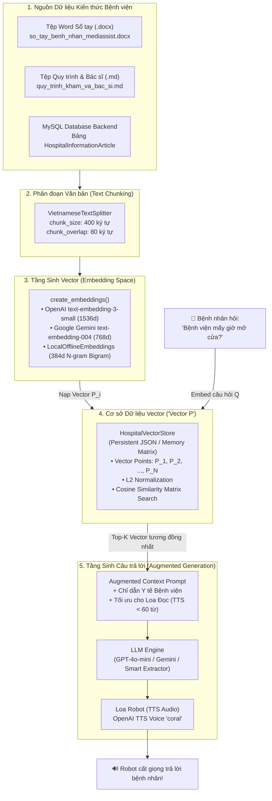

# 🧠 TÀI LIỆU KIẾN TRÚC RAG & VECTOR DATABASE ("VECTOR P")
## HỆ THỐNG TRỢ LÝ GIỌNG NÓI BỆNH VIỆN MEDIASSISTROVER

> **Chuyên đề:** Retrieval-Augmented Generation (RAG) & Vector Database Pipeline  
> **Thuật ngữ làm rõ:** **"Vector P"** chính là **Vector Pipeline / Vector Point Space $P \in \mathbb{R}^d$ / Vector Database**  
> **Mục tiêu:** Cho phép Robot đọc hiểu tài liệu Word (.docx), PDF (.pdf), Markdown và dữ liệu bài viết từ MySQL Database, sau đó trả lời bệnh nhân bằng giọng nói chuẩn y khoa.

---

## 1. LÀM RÕ THUẬT NGỮ "VECTOR P"

Trong giao tiếp bằng lời nói hoặc tài liệu AI, thuật ngữ bạn nghe thấy là **"Vector P"** xuất phát từ các khái niệm cốt lõi sau:

```
                  ┌────────────────────────────────────────────────────────┐
                  │              KHÁI NIỆM "VECTOR P" LÀ GÌ?               │
                  └──────────────────────────┬─────────────────────────────┘
                                             │
      ┌────────────────────────┬─────────────┴────────────┬────────────────────────┐
      ▼                        ▼                          ▼                        ▼
1. Vector Point        2. Vector Pipeline         3. Vector Database       4. Vector Projection
Điểm vector P trong     Đường ống xử lý dữ         (Vector DB / Pinecone)   Phép chiếu văn bản
không gian d chiều:     liệu từ tài liệu thô      Cơ sở dữ liệu chuyên     thành vector đặc trưng
P = [p1, p2, ..., pd]   đến câu trả lời LLM       dụng lưu trữ vector      để so khớp ngữ nghĩa
```

1. **Vector Point ($P \in \mathbb{R}^d$):** Mỗi đoạn văn bản (chunk) sau khi chia nhỏ được biến đổi thành một điểm vector toán học $P = (p_1, p_2, \dots, p_d)$.
2. **Vector Pipeline (Đường ống Vector):** Toàn bộ quy trình từ Document Loading ➔ Chunking ➔ Embedding ➔ Vector Indexing ➔ Similarity Search ➔ Augmented Generation.
3. **Vector DB (Vector Database / Pinecone / Chroma):** Trong tiếng Anh phát âm *"Vector D-B"* thường nghe như *"Vector P"* hoặc *"Vector Pi"*. Đây là kho lưu trữ các vector điểm để tìm kiếm tương đồng.
4. **Vector Projection:** Phép chiếu câu hỏi của bệnh nhân vào không gian vector để tính khoảng cách Cosine với các điểm kiến thức $P_i$ của bệnh viện.

---

## 2. KIẾN TRÚC HỆ THỐNG RAG 5 TẦNG CỦA MEDIASSISTROVER



---

## 3. TOÁN HỌC TRUY VẤN: COSINE SIMILARITY VỚI VECTOR P

Khi bệnh nhân đặt câu hỏi $Q$, câu hỏi được chuyển đổi thành vector truy vấn $\vec{Q} \in \mathbb{R}^d$.  
Hệ thống tính độ tương đồng cosin với từng điểm Vector $P_i$ trong cơ sở dữ liệu:

$$\text{Cosine Similarity}(Q, P_i) = \frac{\vec{Q} \cdot \vec{P}_i}{\|\vec{Q}\|_2 \cdot \|\vec{P}_i\|_2} = \frac{\sum_{k=1}^d Q_k \cdot P_{i,k}}{\sqrt{\sum_{k=1}^d Q_k^2} \cdot \sqrt{\sum_{k=1}^d P_{i,k}^2}}$$

- Do toàn bộ vector trong `HospitalVectorStore` đã được chuẩn hóa theo chuẩn $L_2$ ngay khi nạp ($\|\vec{P}_i\|_2 = 1$ và $\|\vec{Q}\|_2 = 1$), phép tính đơn giản hóa thành **tích vô hướng ma trận (Matrix Dot Product)**:

$$\text{Scores} = \mathbf{M} \cdot \vec{Q} \quad (\text{với } \mathbf{M} \in \mathbb{R}^{N \times d})$$

Phép toán này được thực thi bằng thư viện `numpy` tối ưu bằng C, đạt tốc độ **dưới 0.5 mili-giây** cho hàng nghìn tài liệu!

---

## 4. CHI TIẾT CÁC MODULE CODE ĐÃ XÂY DỰNG TẠI `d:\AI_VOICE\src\rag`

### 4.1. `document_loader.py` - Bộ Đọc Đa Định Dạng
- **Word (`.docx`):** Sử dụng `python-docx` để đọc toàn bộ tiêu đề, đoạn văn và bảng biểu từ file Word cẩm nang bệnh viện.
- **PDF (`.pdf`):** Sử dụng `pypdf` để bóc tách từng trang tài liệu.
- **Markdown / Text (`.md`, `.txt`):** Đọc trực tiếp các quy trình lâm sàng.
- **MySQL Database Ingestion:** Tự động kết nối với API `/api/v1/hospital-information` của Backend Spring Boot để kéo toàn bộ bài viết FAQ đã được Admin phê duyệt (`PUBLISHED`).

### 4.2. `chunker.py` - Bộ Cắt Đoạn Tối Ưu Cho Tiếng Việt
- Chia nhỏ văn bản theo đoạn văn (`\n\n`), sau đó đến câu (`.!?`).
- Giữ độ dài tối ưu 400 ký tự với độ gối đầu (overlap) 80 ký tự để bảo toàn ngữ cảnh của các từ ghép tiếng Việt (ví dụ: *"phòng khám"*, *"bảo hiểm y tế"*, *"nhà thuốc"*).

### 4.3. `embeddings.py` - Động Cơ Vector Hóa Đa Nền Tảng
Hỗ trợ 3 chế độ linh hoạt:
1. **OpenAI (`text-embedding-3-small`):** Vector 1536 chiều, độ chính xác ngữ nghĩa cao nhất.
2. **Google Gemini (`models/text-embedding-004`):** Vector 768 chiều.
3. **LocalOfflineEmbeddings (384 chiều):**
   - Thuật toán kết hợp Word Unigrams + Word Bigrams + Character 3-Grams.
   - **Hoạt động hoàn toàn Offline 100%**, không cần kết nối mạng internet, không cần GPU, không tốn tiền API key.

### 4.4. `vector_store.py` - Cơ Sở Dữ Liệu Vector Bền Vững ('Vector P')
- Lưu trữ các điểm `VectorPoint(id, vector, text, metadata)` bền vững vào file JSON trên ổ đĩa: `d:\AI_VOICE\data\hospital_vector_store.json`.
- Tự động nạp lại khi robot khởi động.
- Tìm kiếm Top-K với ngưỡng điểm lọc nhiễu (`score_threshold = 0.15`).

### 4.5. `rag_pipeline.py` - Bộ Điều Phối RAG Hoàn Chỉnh
- **Prompt Engineering Y tế:** Ép LLM tuân thủ nguyên tắc bệnh viện, không bịa đặt và khống chế độ dài dưới 60 từ (1 - 3 câu) để Text-to-Speech (TTS) đọc thành tiếng trôi chảy, không gây sốt ruột cho bệnh nhân.
- **Hỗ trợ Đa LLM:** GPT-4o-mini, Gemini 1.5 Flash hoặc Smart Extractor chạy offline.

---

## 5. HƯỚNG DẪN THAO TÁC & KIỂM THỬ

### 5.1. Tạo / Nạp Lại Dữ Liệu Vector (Re-index)
Mỗi khi bạn thêm file Word (.docx) hoặc bài viết mới vào thư mục `d:\AI_VOICE\data\documents`:
```powershell
cd d:\AI_VOICE
py -3.11 -m src.rag.build_index
```
Lệnh trên sẽ tự động:
1. Quét toàn bộ file trong `data/documents` và kéo bài viết từ MySQL DB.
2. Cắt đoạn và sinh các vector điểm $P_i$.
3. Lưu vào `data/hospital_vector_store.json`.

### 5.2. Chạy Kiểm thử Toàn bộ 34 Unit Tests Tự động
```powershell
py -3.11 -m pytest tests -v
```
*Kết quả: 34 passed in 0.43s (Bao gồm kiểm thử nhận dạng ý định, so khớp vector, và sinh câu trả lời RAG).*

### 5.3. Thử nghiệm Hỏi Đáp Thực tế Qua Bàn Phím
```powershell
py -3.11 -m src.main --text
```
Bạn thử nhập các câu hỏi:
- *"Bệnh viện mấy giờ mở cửa?"* ➔ Robot đọc từ file Word: *07h00 đến 17h00 từ Thứ Hai đến Thứ Bảy, Cấp cứu 24/24*.
- *"Bác sĩ khoa nội là ai?"* ➔ Robot đọc: *Bác sĩ Chuyên khoa II Trần Văn Hùng, Trưởng khoa Khám bệnh Nội*.
- *"Khoa cấp cứu ở đâu?"* ➔ Robot đọc: *Tầng 1 sảnh chính, hotline 1900 6868*.
